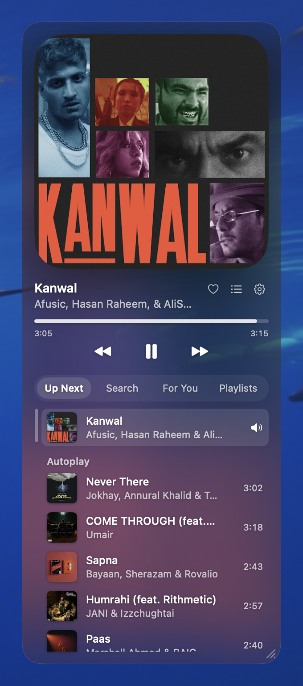

# GlassVinyl

A floating, translucent mini-player for YouTube Music on macOS. It sits on top of your windows, shows the song that's playing, and adds a few things the web app doesn't have: a draggable queue, a playlist manager, a 10-band equalizer, AI song picks and on-device karaoke.



GlassVinyl doesn't play music itself. It controls the YouTube Music tab (or installed web app) in Brave, so your account, recommendations and history stay where they are.

## Features

- **Player card.** Artwork as a square, a round cover or a spinning vinyl disc. Two layouts (art beside or above the controls), adjustable width and translucency, and six audio visualizers.
- **Up Next.** Drag songs to reorder them, hover to play one, remove songs, and see what Autoplay will play after the queue.
- **Search.** Play a result now, play it next, add it to the queue or add it to a playlist.
- **Playlists.** Your YouTube Music playlists and Liked Music, kept in a local copy so they open instantly and can be filtered across every song. Playlists made mostly of regular YouTube videos are hidden. Right-click any song anywhere to add it to a playlist.
- **Like button** on the card, in sync with YouTube Music.
- **Equalizer.** 10 bands from 31 Hz to 16 kHz, a preamp, presets and a limiter so boosts don't distort.
- **For You.** Claude Code reads what you've been playing, searches the web (Reddit threads, music blogs, new-release lists) and suggests songs you haven't heard. Optional.
- **Karaoke.** Removes the vocals from the current song on your Mac with the Mel-Band RoFormer model, then plays the instrumental with a slider for how much vocal to keep. Optional.
- **Listening log.** Every play is recorded with how long you listened and whether you skipped, in `listens.jsonl`, for building playlists later.

## Requirements

- macOS 15 or later on an Apple Silicon Mac.
- [Brave](https://brave.com) with YouTube Music open, either as a tab or as an installed web app.
- For karaoke: [ffmpeg](https://ffmpeg.org) (`brew install ffmpeg`) and about 2 GB of disk space.
- For For You: [Claude Code](https://claude.com/claude-code), signed in. Each refresh uses some of your Claude usage.

## Install

1. Download `GlassVinyl.zip` from [Releases](https://github.com/pranjalanimesh/glassvinyl/releases) and unzip it.
2. Move `GlassVinyl.app` to Applications.
3. The app isn't notarized by Apple, so macOS blocks the first launch. Right-click the app, choose **Open**, then **Open** again. If macOS still refuses, run:
   ```sh
   xattr -dr com.apple.quarantine /Applications/GlassVinyl.app
   ```

GlassVinyl lives in the menu bar (♪) and has no Dock icon.

## First-time setup

1. In Brave, open YouTube Music and sign in.
2. In Brave's menu bar, choose **View → Developer → Allow JavaScript from Apple Events**. GlassVinyl talks to the YouTube Music page through this.
3. When macOS asks whether GlassVinyl may control Brave, click **Allow**.
4. For the visualizers, allow **System Audio Recording** when macOS asks.

To set up karaoke, open Settings (⚙ on the card) → **Karaoke** → **Install**. It creates a Python environment in the app's data folder with [audio-separator](https://github.com/nomadkaraoke/python-audio-separator) and [yt-dlp](https://github.com/yt-dlp/yt-dlp). You can also run [`Resources/install-karaoke.sh`](Resources/install-karaoke.sh) yourself.

## Build from source

You need the Swift toolchain from Xcode or the Command Line Tools (`xcode-select --install`).

```sh
git clone https://github.com/pranjalanimesh/glassvinyl.git
cd glassvinyl
./build.sh
open GlassVinyl.app
```

`build.sh` compiles the Swift package, wraps it in `GlassVinyl.app` and signs it ad hoc. `./build.sh --zip` also writes `dist/GlassVinyl.zip`.

## How it works

YouTube Music runs its player, queue and library inside the web page. GlassVinyl uses AppleScript's `execute javascript` to inject [`Resources/bridge.js`](Resources/bridge.js) into that page. The script reads the player state once a second and calls the page's own queue actions and API requests, the same ones its menus use.

A few parts run outside the page:

| Part | How |
|---|---|
| Visualizers | A Core Audio process tap on your Mac's audio output, analysed with an FFT |
| Equalizer | Web Audio filters on the page's audio element |
| For You | `claude -p` with only web search and fetch allowed, returning songs as JSON |
| Karaoke | yt-dlp downloads the song, ffmpeg converts it, audio-separator runs Mel-Band RoFormer on the GPU |

Everything is stored in `~/Library/Application Support/GlassVinyl`: the listening log, the library copy, recommendations, and the karaoke tools and tracks. Delete that folder to reset the app.

## Limitations

- **Brave only** for now. The same approach would work for Chrome.
- **Breakable.** It depends on the internals of the YouTube Music web page, so a YouTube Music update can break parts of it.
- **Queue changes are local.** Songs you add or reorder live in the page's queue, not YouTube's server copy of it.
- **Karaoke downloads songs.** yt-dlp is against YouTube's terms of service. Karaoke is optional and off until you install it; use it at your own discretion.

GlassVinyl isn't affiliated with or endorsed by Google or YouTube.

## License

[MIT](LICENSE)
